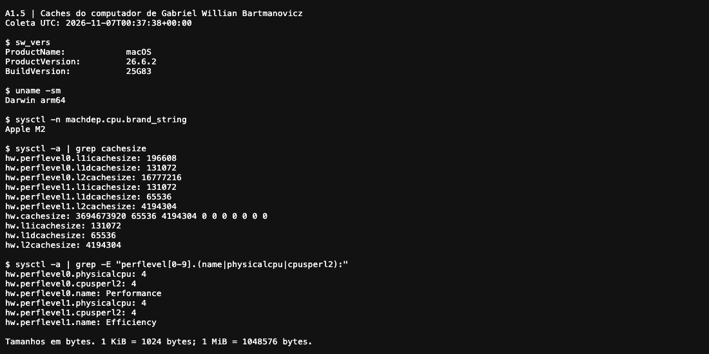
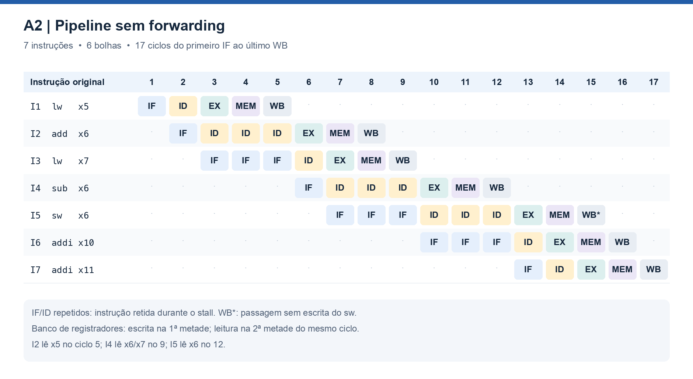
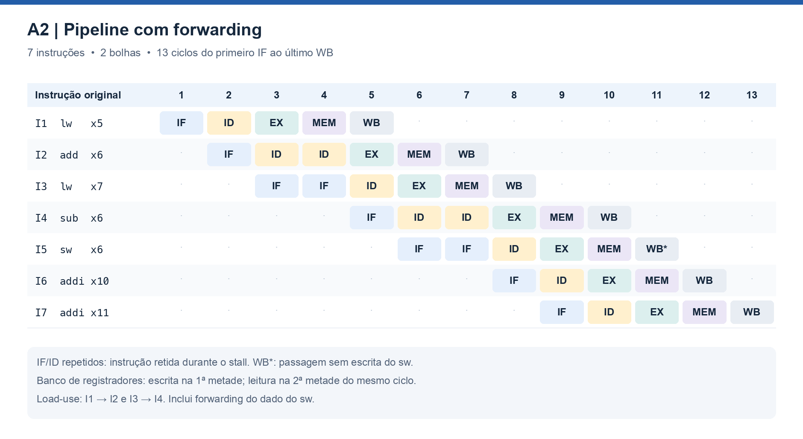
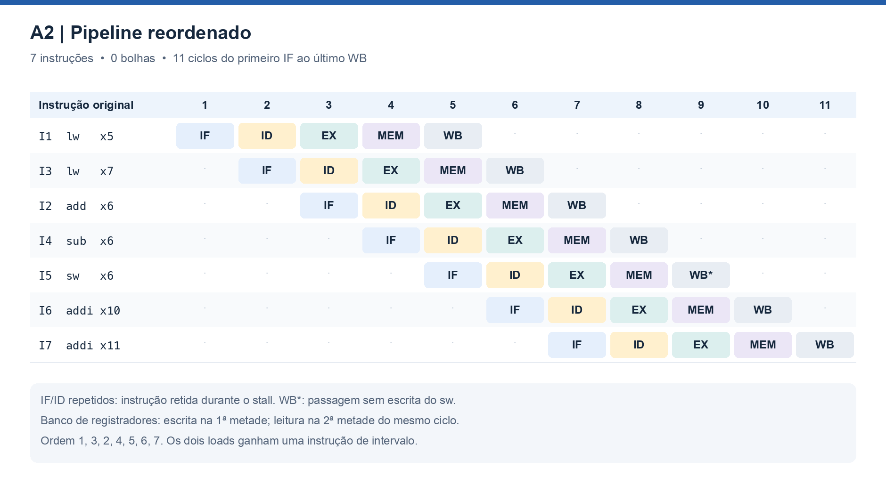
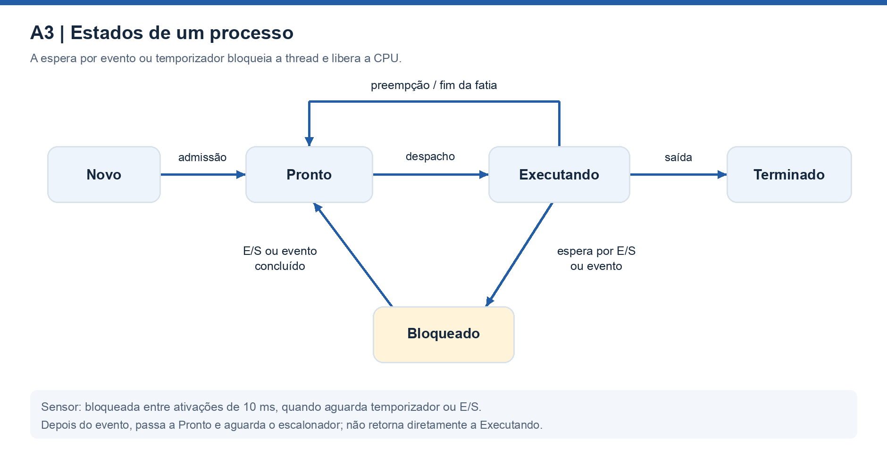
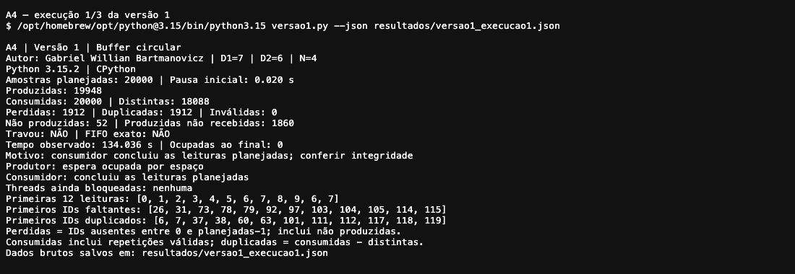
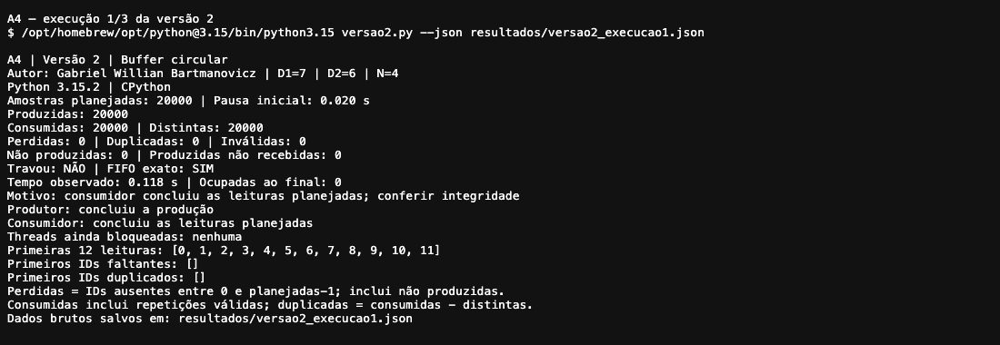
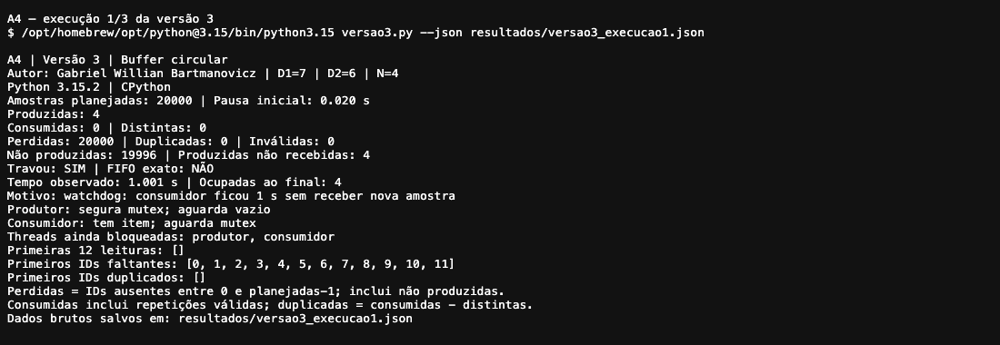
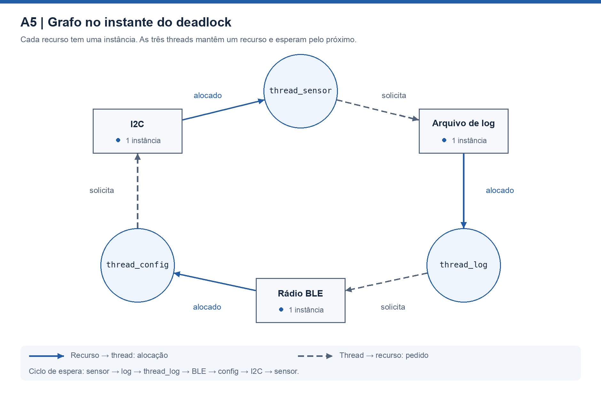

Gabriel Willian Bartmanovicz — D1 = 7; D2 = 6; N = 4.

# Ponderada Computação CC08: do pipeline ao deadlock

## Parâmetros individuais e critérios

O nome considerado é **Gabriel Willian Bartmanovicz**: `Gabriel = 7`, `Willian = 7` e `Bartmanovicz = 12` letras, totalizando 26. Logo:

$$
D1 = 7,\qquad D2 = (7+7+12)\bmod 10 = 6
$$

$$
IC = 100.000+20.000\times6 = 220.000\ \text{instruções/amostra}
$$

$$
m = 3\%+0,5\%\times7 = 6,5\% = 0,065
$$

$$
N = 3+(6\bmod5) = 4\ \text{posições}
$$

O período de amostragem é `1/100 Hz = 10 ms`, mas o prazo de processamento de **cada amostra é 5 ms**. Terminar antes da próxima leitura não basta se esses 5 ms forem ultrapassados. Os valores de hardware e custo usados a seguir são os do enunciado, não medições da pulseira.

# Parte A — O problema técnico

## A1. Arquitetura e memória

### A1.1. Plataforma H

O tempo de CPU é a quantidade de instruções multiplicada pelos ciclos por instrução, dividida pelos ciclos por segundo:

$$
T_H = \frac{IC\times CPI}{f}
=\frac{220.000\times1,5}{48.000.000}
=0,006875\ s=\boxed{6,875\ ms}
$$

São `330.000 ciclos` por amostra. **A H sem DSP não atende:** excede o prazo em `6,875 − 5 = 1,875 ms`. Embora caiba no período de 10 ms, falha no requisito de latência.

### A1.2. Plataforma V: AMAT, CPI e atraso do Linux

Adoto os **120 ciclos como penalidade adicional da falta**, coerentemente com a fórmula de CPI fornecida no enunciado. O tempo médio de acesso à memória inclui o tempo de acerto e a penalidade ponderada pela taxa de falta [R1]:

$$
AMAT = T_{acerto}+m\times P_{falta}
=1+0,065\times120
=\boxed{8,8\ ciclos/acesso}
$$

Como `1 ciclo = 1/(1,2 × 10⁹) s = 0,833333 ns`, o AMAT também equivale a:

$$
AMAT=8,8\times0,833333\approx\boxed{7,333333\ ns}
$$

O CPI básico já inclui o caso sem faltas. Acrescento apenas as paradas das faltas, sem contabilizar novamente o custo dos acertos:

$$
CPI_{efetivo}=1,0+1,3\times0,065\times120
=1+10,14=\boxed{11,14}
$$

$$
T_V=\frac{220.000\times11,14}{1.200.000.000}
=\frac{2.450.800}{1.200.000.000}\ s
\approx\boxed{2,042333\ ms}
$$

Somando o atraso máximo do sistema operacional informado:

$$
T_{V,\ pior\ caso\ do\ modelo}=2,042333+3
\approx\boxed{5,042333\ ms}
$$

**A V atende no tempo médio calculado, mas falha no pior caso solicitado**, excedendo 5 ms em aproximadamente `0,042333 ms`. Uma taxa média de faltas não fornece um limite rigoroso de pior tempo de execução (WCET); os `5,042333 ms` são o resultado do modelo simplificado pedido, e não uma garantia temporal para qualquer carga Linux.

### A1.3. DSP e Lei de Amdahl

O filtro representa `p = 0,60` do tempo original e acelera `s = 5` vezes. Os outros 40% continuam com o mesmo custo:

$$
S_{global}=\frac{1}{(1-p)+p/s}
=\frac{1}{0,40+0,60/5}
=\frac{1}{0,52}
\approx\boxed{1,923077}
$$

$$
T_{H+DSP}=T_H\times0,52
=6,875\times0,52
=\boxed{3,575\ ms}
$$

Conferindo pelas parcelas: o filtro passa de `6,875 × 0,60 = 4,125 ms` para `4,125/5 = 0,825 ms`; os demais trechos continuam em `6,875 × 0,40 = 2,750 ms`. A soma é `0,825 + 2,750 = 3,575 ms`.

**Agora atende ao modelo**, com margem de `5 − 3,575 = 1,425 ms`, ou `1,425/5 = 28,5%` do prazo. A aceleração global não é 5 vezes porque só o filtro recebeu o DSP. Na implementação, transferências para o DSP, interrupções e outros custos não incluídos precisam caber nessa margem.

| Configuração | Processamento calculado | Atraso adicional do SO | Tempo considerado | Atende 5 ms? |
| --- | ---: | ---: | ---: | --- |
| H | 6,875000 ms | 0 ms | 6,875000 ms | Não |
| V | 2,042333 ms | até 3 ms | 5,042333 ms | Não no pior caso do modelo |
| H + DSP | 3,575000 ms | 0 ms | 3,575000 ms | Sim, no modelo |

### A1.4. Por que cache na V e não na H? — quatro linhas

Na V, a CPU de 1,2 GHz acessa DRAM externa lenta, e instruções e dados disputam o caminho para a memória: o gargalo de Von Neumann.<br>
A cache mantém conteúdo próximo ao processador e reduz a frequência desses acessos lentos, explorando localidade [R1].<br>
Na H descrita, instruções e dados têm caminhos separados, e a SRAM interna responde em um ciclo, de modo previsível.<br>
Assim, nesse hardware a cache não é necessária para esconder a latência informada; ser Harvard, por si só, não proíbe o uso de cache.

### A1.5. Evidência das caches e classificação da arquitetura

**Origem da evidência:** coleta no computador do autor, com macOS 26.6.2, arquitetura arm64 e processador Apple M2. O registro contém a data UTC efetiva da coleta. O comando do enunciado foi complementado pelos campos `hw.perflevel`, pois o processador possui núcleos de desempenho e de eficiência com caches diferentes.



Registro integral: [cache_macos.txt](img/cache_macos.txt). O print é uma captura da página local de evidências no navegador, exibindo a saída dos comandos executados no Mac; não é uma janela do aplicativo Terminal nem uma imagem desenhada de terminal.

| Grupo observado | Núcleos | L1 de instruções por núcleo | L1 de dados por núcleo | L2 por grupo |
| --- | ---: | ---: | ---: | ---: |
| `perflevel0` — Performance | 4 | 196.608 B = 192 KiB | 131.072 B = 128 KiB | 16.777.216 B = 16 MiB |
| `perflevel1` — Efficiency | 4 | 131.072 B = 128 KiB | 65.536 B = 64 KiB | 4.194.304 B = 4 MiB |

**A L1 é dividida em instruções e dados nos dois grupos.** Isso é uma organização Harvard modificada nas caches. Na visão do programa, código e dados pertencem ao mesmo espaço de endereçamento e usam a memória principal unificada: a classificação é **Von Neumann nessa visão**, sem os espaços de memória separados de um Harvard puro [R9].

Os valores de `sysctl` estão em bytes; as conversões usam `1 KiB = 1024 B` e `1 MiB = 1.048.576 B`. O campo `cpusperl2 = 4` mostra que quatro núcleos compartilham a L2 de cada grupo. Os campos genéricos `hw.l1icachesize`, `hw.l1dcachesize` e `hw.l2cachesize` correspondem ao grupo menos performante, e não à soma de todos os núcleos. Essa interpretação segue a documentação da Apple [R8]. Não deduzo uma L3 ou uma cache de sistema a partir de campos que não as identificam.

## A2. Pipeline: o loop do filtro

### Convenções

O pipeline é em ordem e tem cinco estágios: **IF, ID, EX, MEM e WB**. Considero somente hazards de dados, sem conflitos estruturais entre IF e MEM. O banco de registradores escreve na primeira metade do ciclo e lê na segunda, como especificado. Portanto, WB e a leitura dependente em ID podem ocorrer no mesmo ciclo.

Na versão com forwarding, há encaminhamento para a ALU **e para o dado gravado por `sw`**. `WB*` nos diagramas é a passagem neutra da store pelo quinto estágio: `sw` altera a memória em MEM e não escreve um registrador. IF/ID repetidos significam retenção durante um stall, não reexecução da instrução. Essas convenções fixam as hipóteses necessárias à contagem [R2].

```asm
# Trecho original: identificadores I1 a I7 correspondem às linhas abaixo.
lw   x5, 0(x10)       # I1: amostra nova
add  x6, x6, x5       # I2: soma += nova
lw   x7, 0(x11)       # I3: amostra antiga
sub  x6, x6, x7       # I4: soma -= antiga
sw   x6, 0(x12)       # I5: grava soma
addi x10, x10, 4      # I6: avança ponteiro da nova
addi x11, x11, 4      # I7: avança ponteiro da antiga
```

### A2.1. Dependências RAW

| Instrução produtora | Instrução consumidora | Registrador | Valor necessário |
| --- | --- | --- | --- |
| I1 — `lw` | I2 — `add` | x5 | Amostra nova. |
| I2 — `add` | I4 — `sub` | x6 | Soma após adicionar a amostra nova. |
| I3 — `lw` | I4 — `sub` | x7 | Amostra antiga. |
| I4 — `sub` | I5 — `sw` | x6 | Soma final que deve ser armazenada. |

I5 precisa da versão de x6 produzida por **I4**; a relação I2 → I5 é transitiva, não outra dependência RAW direta. I1 deve ler x10 antes de I6 atualizá-lo, e I3 deve ler x11 antes de I7 atualizá-lo: essas restrições de reordenação são **WAR**, não RAW. Dependências entre iterações não entram na contagem deste trecho isolado.

### A2.2. Sem forwarding



I2 só pode ler x5 no ciclo 5, quando I1 escreve o registrador: são **duas bolhas**. I4 aguarda x6 de I2, disponível no ciclo 8, e x7 de I3, disponível no ciclo 9: a última condição determina a saída, acrescentando **duas bolhas**, sem somar as esperas sobrepostas. I5 aguarda x6 de I4 até o ciclo 12, acrescentando **duas bolhas**.

$$
C_{sem}=n+(k-1)+bolhas=7+(5-1)+2+2+2=\boxed{17\ ciclos}
$$

A contagem vai do IF de I1 no ciclo 1 ao WB de I7 no ciclo 17.

### A2.3. Com forwarding



Permanecem duas ocorrências de **load-use**: I1 → I2 por x5 e I3 → I4 por x7. Cada uma exige uma bolha. O primeiro `lw` entrega o dado ao final de MEM no ciclo 4; o `add` só pode usá-lo em EX no ciclo 5. Analogamente, o segundo `lw` conclui MEM no ciclo 7, e o `sub` passa a EX no ciclo 8. Forwarding não produz antecipadamente um dado que ainda está sendo lido.

As demais dependências são resolvidas pelo encaminhamento, inclusive `sub → sw` para o dado da store:

$$
C_{com}=7+(5-1)+1+1=\boxed{13\ ciclos}
$$

### A2.4. Reordenação sem bolhas

Troco somente as posições de I2 e I3:

```asm
# Reordenação: I1, I3, I2, I4, I5, I6, I7.
lw   x5, 0(x10)       # I1
lw   x7, 0(x11)       # I3: trabalho independente entre lw x5 e add
add  x6, x6, x5       # I2: também separa lw x7 de sub
sub  x6, x6, x7       # I4
sw   x6, 0(x12)       # I5
addi x10, x10, 4      # I6
addi x11, x11, 4      # I7
```



Agora há uma instrução independente entre cada load e o primeiro uso do dado. O `add → sub` e o `sub → sw` usam forwarding. Os loads continuam na mesma ordem relativa, antes da store, e os ponteiros só mudam depois das respectivas leituras. Assim, o resultado é preservado, inclusive se os endereços de memória coincidirem.

$$
C_{reordenado}=7+(5-1)=\boxed{11\ ciclos}
$$

## A3. Processos e threads

### A3.1. Organização proposta para a Plataforma V

| Componente | Organização | Responsabilidade e comunicação |
| --- | --- | --- |
| Sensor | Thread persistente do processo de controle | Acorda a cada 10 ms, lê a amostra e a publica em um buffer limitado. |
| Processamento | Thread persistente do mesmo processo | Consome a amostra e calcula o comando de vibração. |
| Motor | Thread persistente do mesmo processo | Aplica o comando validado, com prioridade sobre atividades de log. |
| BLE | Processo separado, com permissões mínimas | Envia logs e recebe configurações por IPC limitado; não altera diretamente a memória do controle. |

Sensor, processamento e motor compartilham buffers no mesmo espaço de endereçamento, evitando a cópia por IPC em cada passagem interna. Threads ainda têm pilha e registradores próprios; criar e trocar entre elas costuma ter menos custo que organizar tudo em processos independentes, mas a troca de contexto não é gratuita. Os contextos são criados uma vez na inicialização, não a cada amostra [R3, R4].

O custo aceito é a menor contenção de falhas dentro do processo de controle: um defeito de memória em uma dessas threads pode derrubar o conjunto. O benefício é manter curto o caminho sensor–filtro–motor. Já o BLE precisa de isolamento porque processa entrada externa e pode travar sem que a vibração deva parar.

O controle envia logs por uma fila IPC de capacidade fixa e operação não bloqueante: se a fila encher, descarta o registro e contabiliza a perda. Configurações recebidas têm tamanho, frequência, tipos e faixas validados; a aplicação efetiva ocorre em um ponto seguro entre amostras. Não mantenho um lock do controle enquanto espero o celular responder.

Essa divisão organiza responsabilidades e reduz dependências, mas **não corrige, por si só, os 5,042333 ms da V calculados em A1**. Para essa plataforma cumprir o requisito seria necessário reduzir e demonstrar os limites de latência do sistema, não apenas criar threads de prioridade alta.

### A3.2. Uma falha explorada no BLE

Como **thread do processo principal**, o BLE compartilha o mesmo espaço de memória, descritores e credenciais do processo [R4]. Uma execução de código indevida pode alterar amostras, comandos do motor e parâmetros de distância, além de interromper o processo inteiro. Uma pilha por thread não é uma fronteira de segurança.

Como **processo separado**, o BLE encontra uma fronteira de memória imposta pelo sistema operacional. Para tornar essa fronteira útil, ele deve ter identidade/permissões restritas, sem acesso direto ao dispositivo do motor, sem permissão de inspecionar o processo crítico e sem memória compartilhada gravável que exponha seus dados internos. O serviço recebe somente os recursos necessários ao rádio e ao IPC.

A separação reduz o alcance de uma invasão; ela não torna automaticamente confiável uma mensagem recebida. Um BLE comprometido ainda pode enviar configurações maliciosas ou sobrecarregar a fila. Por isso, o controle autentica/valida as solicitações e limita a taxa de processamento. Uma falha no próprio kernel também ultrapassa essa fronteira.

### A3.3. Estados de um processo



O processo novo é admitido em **pronto**; o escalonador o despacha para **executando**. Uma preempção o devolve a pronto. Ao esperar E/S, evento ou temporizador, passa a **bloqueado**; a conclusão do evento o torna pronto novamente. Ao terminar, entra em **terminado**. O despertar não lhe garante a CPU imediatamente [R5].

Na organização proposta, a **thread do sensor passa a maior parte do tempo bloqueada**, aguardando o temporizador periódico ou a conclusão da leitura por interrupção. Ela lê/publica rapidamente e volta a esperar pelo próximo período de 10 ms. Não faz espera ocupada. Em um processo com várias threads, uma pode estar bloqueada enquanto outra executa; os estados descritos aplicam-se individualmente às entidades escalonadas.

## A4. Buffer circular com semáforos

### A4.1. Implementação e método

As três versões usam Python 3 e `threading`, com **N = 4**. Os programas e seus cabeçalhos/docstrings estão em [codigo](codigo/). Cada execução tem meta de **20.000 amostras**, sequência esperada de `0` a `19.999`, e é iniciada em um processo novo pelo executor.

Na versão 1, o contador compartilhado de ocupação é atualizado por leitura, `time.sleep(0)` e escrita, sem exclusão mútua. A verificação de buffer cheio/vazio é feita com espera ocupada. Nas três versões, o consumidor recebe a mesma pausa inicial de **20 ms**; ela permite ao produtor preencher o buffer e evidencia a ordem perigosa da versão 3. A pausa não altera artificialmente os semáforos nem injeta contagens incorretas.

O monitor usa tempo monotônico e considera travamento **1 segundo sem consumo enquanto a coleta ainda não concluiu**. A outra condição de encerramento é o consumidor alcançar **20.000 retiradas**, ainda que contenham duplicatas. Nesse caso o observador também interrompe a produção que estiver pendente: atingir a meta de leituras não comprova a geração ou a entrega dos 20.000 identificadores. Os campos de integridade e de amostras não produzidas tornam esse caso explícito.

Ao encerrar, o monitor registra o estado das threads e termina o processo do experimento. Não libera `mutex`, `vazio` ou `cheio` para fingir que o deadlock foi resolvido. Assim, o teste não prende indefinidamente o terminal.

Este é um **ensaio de concorrência**, com produção tão rápida quanto possível, e não uma medição de cumprimento dos 5 ms nem uma simulação temporal dos 100 Hz. O GIL do CPython não transforma uma sequência de leitura–modificação–escrita em operação indivisível; a cessão explícita entre as etapas permite a intercalação que o exercício quer demonstrar [R6].

### A4.2. Definição das métricas

| Métrica | Definição usada |
| --- | --- |
| Consumidas | Quantidade de valores válidos retirados pelo consumidor, contando repetições. |
| Únicas | Quantidade de identificadores distintos válidos recebidos. |
| Perdidas | `20.000 − únicas`: amostras esperadas que não chegaram até o encerramento. |
| Duplicadas | `consumidas − únicas`: ocorrências adicionais de identificadores já recebidos. |
| Geradas | Quantidade de amostras efetivamente inseridas pelo produtor antes de concluir ou parar. |
| Inválidas | Leituras de posições sem um identificador válido; registradas separadamente. |
| Travou | O monitor detectou pelo menos 1 segundo sem consumo, com trabalho ainda pendente. |

Em uma execução interrompida, **“perdidas” inclui amostras ainda não produzidas**. Portanto, não significa que todas foram sobrescritas dentro do buffer. Os resultados completos separam geradas, não geradas e geradas não recebidas para tornar essa diferença verificável.

### A4.3. Nove execuções reais

<!-- RESULTADOS_A4_INICIO -->
**Ambiente medido:** Mac do autor, Apple M2, macOS 26.6.2 arm64, CPython 3.15.2. Os registros foram coletados em **06/11/2026 no horário de São Paulo**; os JSON guardam o horário UTC completo. Todas as execuções usam **N = 4** e meta de **20.000 amostras**.

| Versão | Execução | Produzidas | Consumidas | Perdidas | Duplicadas | Inválidas | Travou? |
| --- | ---: | ---: | ---: | ---: | ---: | ---: | :---: |
| 1 | 1 | 19948 | 20000 | 1912 | 1912 | 0 | Não |
| 1 | 2 | 19950 | 20000 | 1875 | 1875 | 0 | Não |
| 1 | 3 | 19824 | 20000 | 2037 | 2037 | 0 | Não |
| 2 | 1 | 20000 | 20000 | 0 | 0 | 0 | Não |
| 2 | 2 | 20000 | 20000 | 0 | 0 | 0 | Não |
| 2 | 3 | 20000 | 20000 | 0 | 0 | 0 | Não |
| 3 | 1 | 4 | 0 | 20000 | 0 | 0 | Sim |
| 3 | 2 | 4 | 0 | 20000 | 0 | 0 | Sim |
| 3 | 3 | 4 | 0 | 20000 | 0 | 0 | Sim |

**Leitura dos resultados.** Na versão 1, todas as execuções atingiram 20.000 leituras, mas nenhuma entregou corretamente os 20.000 identificadores:

- Execução 1: 18088 IDs distintos, 1912 duplicações e 1912 IDs ausentes; destes, 52 não foram produzidos e 1860 foram produzidos, mas não recebidos.
- Execução 2: 18125 IDs distintos, 1875 duplicações e 1875 IDs ausentes; destes, 50 não foram produzidos e 1825 foram produzidos, mas não recebidos.
- Execução 3: 17963 IDs distintos, 2037 duplicações e 2037 IDs ausentes; destes, 176 não foram produzidos e 1861 foram produzidos, mas não recebidos.

As três terminaram sem acionar o watchdog. Esse encerramento ocorreu pela meta de leituras, e **não significa entrega correta**: duplicatas contam como novas retiradas, e o monitor interrompe a produção ainda pendente.

Na versão 2, as três sequências foram exatamente `0, 1, 2, …, 19.999`, sem perdas, duplicações, leituras inválidas ou travamentos. Na versão 3, as três execuções bloquearam com **quatro amostras no buffer e nenhuma consumida**: os 20.000 IDs ausentes correspondem a **19.996 não produzidos + 4 produzidos não recebidos**. As etapas registradas confirmam o produtor segurando `mutex` e esperando `vazio`, e o consumidor esperando `mutex`.

**Validação automática: aprovada.** As contagens foram recalculadas a partir das sequências brutas e comparadas aos JSON, CSV e logs; o FIFO integral da versão 2 passou nas três repetições.
<!-- RESULTADOS_A4_FIM -->

Os logs e métricas completos estão em [codigo/resultados](codigo/resultados/). As imagens abaixo são capturas reais do navegador local exibindo os TXT da primeira execução de cada versão. A origem da captura é a mesma descrita em A1.5. Os valores da tabela e das imagens correspondem aos registros desta rodada.







### A4.4. Região crítica e corrida na versão 1

A região crítica é a operação lógica que verifica disponibilidade, acessa `buffer[indice]`, avança o índice circular e atualiza a ocupação. Mesmo com um único produtor e um único consumidor, **ambos escrevem no contador compartilhado**. A atualização precisa ser coordenada com o estado do buffer.

Exemplo de atualização perdida, com ocupação inicial igual a 1:

| Passo | Produtor | Consumidor |
| --- | --- | --- |
| 1 | Insere uma amostra, avança o índice, lê `ocupadas = 1` e cede a CPU. | — |
| 2 | — | Retira uma amostra e lê `ocupadas = 1`; cede a CPU. |
| 3 | Grava `ocupadas = 2` usando a leitura antiga. | — |
| 4 | — | Grava `ocupadas = 0` usando a leitura antiga. |

O valor correto final seria `1 + 1 − 1 = 1`, mas o contador informa 0. Invertendo as duas últimas escritas, ele pode informar 2. A divergência faz o produtor acreditar em espaço inexistente ou o consumidor acreditar em itens inexistentes: amostras podem ser sobrescritas, valores antigos podem ser lidos outra vez e uma thread pode esperar indefinidamente por uma condição que o contador representa incorretamente. A frequência e os números dependem do escalonamento.

### A4.5. O papel de cada semáforo na versão 2

| Semáforo | Valor inicial | Garantia |
| --- | ---: | --- |
| `vazio` | N = 4 | O produtor só insere após reservar uma vaga; evita sobrescrever uma posição ainda ocupada. |
| `cheio` | 0 | O consumidor só retira após reservar um item publicado; evita consumir uma posição vazia. |
| `mutex` | 1 | Uma thread por vez altera a estrutura e seus índices/contador dentro da região crítica. |

A ordem implementada é [R6, R7]:

```text
# Protocolo do produtor correto
P(vazio)
P(mutex)
inserir amostra e avançar índice
V(mutex)
V(cheio)

# Protocolo do consumidor correto
P(cheio)
P(mutex)
retirar amostra e avançar índice
V(mutex)
V(vazio)
```

Nenhuma thread segura o mutex enquanto espera existir vaga ou amostra. Cada inserção publica exatamente um item e cada retirada devolve exatamente uma vaga. A ocupação fica entre `0` e `N`; nos pontos sem reservas intermediárias, `vazio + cheio = N`. Durante uma operação, uma vaga/item pode estar reservado, de modo que não uso essa soma como invariante de todo instante.

Nas três execuções da versão correta, o verificador também compara **toda a sequência recebida** com `list(range(20000))`. Contar 20.000 itens sozinho seria insuficiente: uma duplicata poderia compensar uma perda. O resultado é uma evidência experimental; a justificativa da correção vem do protocolo, supondo que as threads continuem sendo escalonadas e não falhem dentro da região crítica.

### A4.6. Por que a versão 3 trava

O produtor troca somente a ordem inicial por `P(mutex); P(vazio)`. Depois de preencher as quatro posições, ele tenta inserir a quinta amostra: adquire `mutex`, mas bloqueia em `vazio`, que está em zero. O consumidor consegue reservar um item em `cheio`, mas bloqueia ao tentar entrar em `mutex`.

O produtor espera uma vaga que somente o consumidor pode devolver. O consumidor espera o mutex retido pelo produtor. A espera é circular e nenhuma das duas threads alcança o `V` necessário para a outra progredir [R7]. O watchdog apenas identifica a ausência de progresso e encerra o ensaio; **não corrige a ordem errada**. Sem a pausa inicial o mesmo defeito continua possível, mas sua manifestação dependeria do escalonamento.

## A5. Deadlock entre I2C, log e BLE

### A5.1. Sequência que leva ao bloqueio

Os três recursos têm uma instância protegida por semáforo binário. Uma intercalação possível é:

1. `thread_sensor` executa `P(i2c)` e `le_sensor()`, mantendo I2C.
2. `thread_log` executa `P(log)` e `le_log()`, mantendo o arquivo de log.
3. `thread_config` executa `P(ble)` e `recebe_comando()`, mantendo BLE. Considere que o comando já chegou, de modo que ela avança ao próximo `P`.
4. `thread_sensor` tenta `P(log)` e bloqueia porque o log está com `thread_log`.
5. `thread_log` tenta `P(ble)` e bloqueia porque BLE está com `thread_config`.
6. `thread_config` tenta `P(i2c)` e bloqueia porque I2C está com `thread_sensor`.



No grafo, **recurso → thread** significa recurso alocado; **thread → recurso** significa pedido bloqueado. As alocações são `I2C → sensor`, `log → log_thread` e `BLE → configuração`. Os pedidos são `sensor → log`, `log_thread → BLE` e `configuração → I2C`. Existe um ciclo envolvendo as três threads e os três recursos; como cada recurso tem uma única instância, esse ciclo caracteriza o deadlock.

### A5.2. Quatro condições necessárias

| Condição | Como aparece neste código |
| --- | --- |
| Exclusão mútua | Cada semáforo binário admite apenas uma thread no uso de seu recurso. |
| Posse e espera | Cada thread mantém o primeiro recurso enquanto tenta obter o segundo. |
| Ausência de preempção | O recurso só é liberado pelo `V` da thread que o utiliza; o código não o retira à força. |
| Espera circular | Sensor espera log; log espera BLE; configuração espera I2C, mantido pelo sensor. |

As quatro condições coexistem nessa intercalação. Quebrar pelo menos uma delas impede esse deadlock [R10].

### A5.3. Correção 1: prevenção com ordem global

Defino a ordem total **`i2c < log < ble`** e exijo que toda thread adquira os recursos de que precisa nessa ordem, liberando-os na ordem inversa. Sensor usa `i2c → log`, log usa `log → ble`, e configuração passa a usar `i2c → ble`. Assim, nenhuma cadeia de pedidos pode voltar a um recurso de ordem menor e fechar um ciclo [R10].

Para a configuração, **não** basta mover `P(i2c)` para antes de uma espera ilimitada por um comando do celular. Primeiro recebo e valido o comando usando BLE isoladamente, libero o rádio e só depois aplico a configuração; caso a aplicação ainda precise dos dois recursos, adquire `i2c` e então `ble`. Operações de rádio e arquivo devem ser limitadas e não atrasar indefinidamente o sensor.

**Impacto no usuário:** elimina esse congelamento por espera circular. Configurações e logs podem esperar a aquisição ordenada e sofrer atraso, custo preferível à perda da vibração. Ainda é necessário limitar o tempo das regiões críticas para cumprir os 5 ms; ausência de deadlock não implica automaticamente latência adequada.

### A5.4. Correção 2: detecção e recuperação

Um supervisor acompanha proprietários dos recursos e pedidos pendentes. Ao encontrar um ciclo persistente no grafo de espera, confirma o bloqueio. Um timeout ou heartbeat ausente serve como alerta, mas sozinho também pode indicar lentidão ou uma operação de E/S demorada, não prova de deadlock [R11].

A recuperação deve parar os participantes de forma controlada, descartar operações incompletas, reinicializar os estados de I2C/BLE e reconstruir os semáforos e as filas. Se uma thread travada não puder ser encerrada com segurança, um supervisor independente reinicia o processo de controle ou um watchdog independente reinicia o dispositivo. **Não libero simplesmente os semáforos de threads ainda vivas**, pois elas poderiam voltar a executar sobre dados incoerentes.

**Impacto no usuário:** o serviço pode voltar automaticamente, mas existe uma janela sem leitura/vibração válida, além de perda de logs e possível perda da configuração em andamento. Um caminho independente deve sinalizar a indisponibilidade; ele não pode depender do mesmo mutex travado. O usuário recebe orientação de interromper o deslocamento e recorrer ao apoio habitual. Essa estratégia limita a duração da falha, mas não garante o prazo de 5 ms durante a recuperação; é uma proteção complementar à correção estrutural.

# Parte B — Decisão do CTO

## Memorando ao conselho da Tato — Dilema 2

**Decido produzir a Tato com a Plataforma H e o acelerador DSP.**

A H sem DSP leva **6,875 ms** por amostra e descumpre o prazo de 5 ms. Com o DSP, a Lei de Amdahl reduz esse tempo a **3,575 ms**, deixando **1,425 ms de margem**. A V processa em aproximadamente 2,04 ms, mas chega a **5,042333 ms** com o atraso do Linux previsto no enunciado. Escolho a configuração que atende ao prazo no modelo, condicionando a liberação à validação no hardware.

O custo é **R$ 37 por unidade**: R$ 22 da H mais R$ 15 do DSP. Aceito pagar R$ 15 além da H básica para cumprir o requisito. Em relação à V de R$ 70, economizo **R$ 33 por unidade**; num lote hipotético de mil unidades, seriam R$ 33 mil em componentes. Isso não é custo total: faltam desenvolvimento, testes, assistência e manutenção.

Abro mão da atualização pela internet e da flexibilidade do Linux. A empresa assume a rede de assistência e a atualização por cabo; o usuário paga com deslocamento, espera e eventual indisponibilidade da pulseira. Reservarei parte da economia para assistência e unidades de substituição, sem presumir que cubra todos esses custos.

Para quem usa a Tato, o benefício é processar dentro do prazo projetado. O risco permanece: um bug de firmware ou de BLE pode comprometer a vibração. Firmware sem Linux também pode ser explorado; atualização presencial torna a distribuição de correções mais lenta. Exigirei validação de comandos, firmware autenticado e atendimento prioritário para correções críticas. Essas medidas precisam de orçamento próprio.

Suspenderei a liberação se a H com DSP ultrapassar **5 ms** incluindo integração e interrupções. Mudarei para a V se uma configuração demonstrar limite de pior caso de **até 4,5 ms** para o caminho completo e economia comprovada de assistência superior aos **R$ 33 adicionais por unidade**. Até essa evidência existir, OTA não compensa descumprir o prazo.

---

## Referências e origem dos dados

Os parâmetros do produto, preços e dilemas são do enunciado fornecido. As contas e a decisão são desenvolvidas neste trabalho. Os dados experimentais são os registros reais incluídos no repositório. As fontes abaixo fundamentam os conceitos; não são benchmarks das plataformas fictícias H e V.

- **[R1]** MIT OpenCourseWare. [6.004 — Caches and the Memory Hierarchy](https://ocw.mit.edu/courses/6-004-computation-structures-spring-2017/pages/c14/c14s1/). Fórmula de AMAT e localidade.
- **[R2]** Rodolfo Azevedo, Unicamp. [MC732 — Pipelining and Control Dependencies](https://ic.unicamp.br/en/~rodolfo/Cursos/mc732/2026s2/slides/C04C-branch-prediction/). Pipeline de cinco estágios, forwarding e load-use.
- **[R3]** Remzi H. Arpaci-Dusseau e Andrea C. Arpaci-Dusseau. [OSTEP, cap. 26 — Concurrency: An Introduction](https://pages.cs.wisc.edu/~remzi/OSTEP/threads-intro.pdf). Threads, estado e espaço de endereçamento.
- **[R4]** Linux man-pages. [pthreads(7)](https://man7.org/linux/man-pages/man7/pthreads.7.html). Memória e atributos compartilhados por threads.
- **[R5]** Arpaci-Dusseau e Arpaci-Dusseau. [OSTEP, cap. 4 — The Abstraction: The Process](https://pages.cs.wisc.edu/~remzi/OSTEP/cpu-intro.pdf). Estados e transições de processos.
- **[R6]** Python Software Foundation. [Python 3.12 — threading](https://docs.python.org/3.12/library/threading.html). Semáforos, threads, eventos e GIL.
- **[R7]** Arpaci-Dusseau e Arpaci-Dusseau. [OSTEP, cap. 31 — Semaphores](https://pages.cs.wisc.edu/~remzi/OSTEP/threads-sema.pdf). Buffer limitado e ordem de aquisição.
- **[R8]** Apple Developer Documentation. [Determining system capabilities](https://developer.apple.com/documentation/kernel/1387446-sysctlbyname/determining_system_capabilities). Tamanhos de cache por tipo de núcleo, campos genéricos e compartilhamento da L2.
- **[R9]** Cornell University. [CS 3410 — Caches](https://www.cs.cornell.edu/courses/cs3410/2025fa/notes/caches.html). Separação entre caches de instruções e dados.
- **[R10]** University of Wisconsin–Madison. [CS 537 — Deadlock](https://pages.cs.wisc.edu/~solomon/cs537-old/last/deadlock.html). Condições necessárias e prevenção.
- **[R11]** Arpaci-Dusseau e Arpaci-Dusseau. [OSTEP, cap. 32 — Common Concurrency Problems](https://pages.cs.wisc.edu/~remzi/OSTEP/threads-bugs.pdf). Deadlock, detecção e recuperação.
